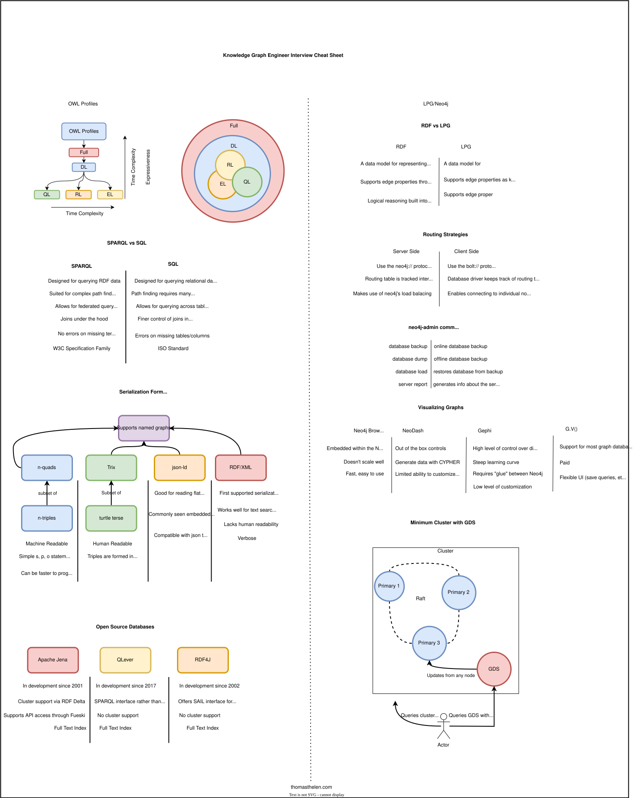
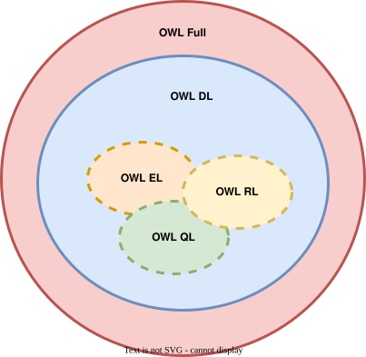

At its core, Knowledge graph engineering is about solving problems by utilizing graph data structures. You may be expressing semantics in predicate logic, computing shortest paths across a network, attaching information to nodes in a netowrk to enhance information retrieval, writing graph database internals, creating node mebeddings for recommendation systems, or creating networks of customers for entity resolution; these are all tried and true places where graphs have found use. To _do_ knowledge graph engineering requires stong systems engineering skills, basic foundations in network science, the ability to read math up to Algebra, and . My reasoning is that 

1. The knowledge graph is only part of a larger system encompasing several backend roles: data pipelines, database administration, and usually supportinhg (or working on) the application layer sitting above the database. 
2. To - these terms come from and are defined in network science.


When it comes to interviewing for a knolwedge graph engineer role, it's important to keep in mind that there are core concepts interviewers will be looking for. These topics usually include schema design, database vendor questions, .

# Cheat Sheet




# RDF/RDFS

RDF is a core piece to the semantic web stack, shown below. Havin an understanding the different layers in the stack help navigate engineering requirements and system design. When interviewing for an RDF role, be prepared to talk about any of the topics in the stack, but focus on core RDF and systems concepts.


## Interview Questions

**What do rdfs:domain and rdfs:range do?**

This is usually one of the first questions that probe for basic knowledge around the first two predicates in the rdfs vocabulary: `rdfs:domain` and `rdfs:range`. 


The most common incorrect answer is usually that `rdfs:domain` and `rdfs:range` place restrictions on the data, the thought process usually being that there is some mechanism to keep a node from being typed based on the restrictions (_that_ would be the role of SHACL).

Instead, the role of `rdfs:domain` `rdfs:range` are to provide the logical reasoner with a r

the following ontology snippet states that the domain and range of the relation `tt:knows` are `foaf:Person`.

```
@prefix rdf: <http://www.w3.org/1999/02/22-rdf-syntax-ns#> .
@prefix rdfs: <http://www.w3.org/2000/01/rdf-schema#> .
@prefix tt: <http://example.org/ontology/> .

tt:Person a owl:Class ;
    rdfs:label "Person" ;

tt:Dog a owl:Class ;
    rdfs:label "Dog" ;

# Object Properties
tt:knows a owl:ObjectProperty ;
    rdfs:label "knows" ;
    rdfs:domain tt:Person ;
    rdfs:range tt:Person ;
    a owl:SymmetricProperty .

tt:SparkyTheDog a tt:Dog .
tt:CharlesTheDog a tt:Dog .
```

The misconception arises as a bug when the a-box, `<tt:SparkyTheDog> tt:knows <tt:CharlesTheDog>` is inserted into the graph and the relations `<tt:SparkyTheDog> rdf:type tt:Person` and `<tt:CharlesTheDog> rdf:type tt:Person` materialize, which is clearly incorrect - but can be traced back to the domain and range axioms previously declared.


**How are types attached to nodes?**

One difference between . This disconnect can be examined by being asked to explain how properties (Eg types) are attached to nodes. The answer should follow that the properties become nodes in the graph, connected with the predicate.

**What reasoning can be done with RDFS? How?**

**What is the difference between RDF, RDFS, and OWL?**

These three technologies form a hierarchy of expressibility, starting with RDF as the base, RDFS as the middleground, and OWL building on top of the two for maximum expressivity.

1. RDF: The base graph data model that is utilized by RDFS and OWL. No one really thinks of this when working with RDF (second nature).
2. RDFS: Builds on RDF by providing a basic vocabulary for building other vocabularies. It supports fairly basic reasoning around class hierarchy and properties. I almost always have some sort of RDFS going on in my ontologies.
3. OWL: Provides additional vocabulary for building more complex ontologies that support enhanced reasoning capabilities (think class intersection, cardinality, etc). This usually enters the picture when some sort of reasoning on the data needs to happen to fill the gap between the source data and the target queries.

**What kinds of reasoning can be done in OWL?**

Within the OWL ecosystem, there are several *profiles* that have guarantees around decidability and supported reasoning strategies. Picking the appropriate profile can be a matter of looking at the types of target queries and the source data - the OWL profile provides the glue between the two.

1. The most common reasoning strategy is RDFS which is guaranteed to be decidable however, it lacks expressive reasoning (mostly subclass reasoning). Because it relies solely on RDFS, it's not an OWL profile. One strategy is to choose RDFS reasoning and then add rules on top of it, if the graph database supports this type of functionality (for example, Jena and GraphDB)
2. OWL Full: The full OWL superset that includes all features in OWL. I've never seen this profile used in production, likely due to it being undecidable for some axioms (although I don't think I've ever seen undecidability in practice).
3. OWL DL: The first subset of OWL which I've also never seen, likely due to exponential complexity guarantees: O(2^polynomial). It also includes a number of OWL features that usually aren't essential.
4. OWL EL: Provides existential quantifiers on class axioms however it lacks support for features such as negation, unions, and cardinality restrictions. It guarantees polynomial time complexity which is better than OWL DL.
5. OWL QL: Guarantees logarithmic scaling w.r.t axioms and is focused more on query-intensive applications (hence QL for query language). Like EL, it lacks cardinality restrictions and quantifiers. I've seen this in use in several production systems.
6. OWL RL: This profile also guarantees polynomial time complexity for reasoning tasks, and places an emphasis on systems that heavily leverage reasoning. From what I've seen - most applications place an emphasis on queryability and less on advanced reasoning. This is probably the reason why I've never seen it used in production systems.



**What are the major triplestore vendors?**

Having a base landscape view of the different graph vendors; there's a change the comapny doing the hiring is using one of these

1. Apache Jena: My go-to for RDF work. It's been around for 25+ years, is open source, supports enterprise features, hasa UI (Fuseki) and is free.
2. RDF4J: Another open source RDF solution that's had years of community development.
3. GraphWise GraphDB: This used to be my go-to until the recent licensing changes. It's a great out-of-the-box solution that includes an intuitive interface. The enterprise version supports additional features like HA clusters.
4. Stardog: Another closed source graph database that provides an out-of-the-box experience. It's locked behind hefty licensing which makes evaluation difficult.
5. QLever: Lightweight, comes with a UI, supports geosparql, and is free.
6. Openlink Virtuoso: Solid graph database that supports billions of nodes with ease. Also involved with the community for some time.
7. Amazon Neptune: Haven't tried it

**Why are graph databases called triplestores, how do they compare to quadstores?**

Graph databases that support RDF are sometimes referred to as *triplestores* because they store RDF triples (s, p, o). Most triplestores are actually quadstores, which support named graphs (s,p,o,g). For historical reasons, most people just say *triplestore* when referring to quadstores.

**When would you use the turtle format instead of n-triples?**

There are a couple of times when using turtle has advantages over n-triples:

1. Human readability is better with turtle
2. Data compression is often better with turtle because of the prefix manifest. When transferring or storing data this could be the optimal format.
3. Some graph databases import data faster as turtle instead of n-triples. Be careful though - others operate faster on n-triples, presumably because the prefix manifest doesn't need to be parsed.

A similar question is comparing trix vs n-quads, which effectively has the same answer.

**How does SPARQL compare to SQL?**

SPARQL queries can generally be transformed to SQL through algebraic processes and differs by placing an emphasis on traversing graph paths. Joins are completed by the processing engine rather than being explicitly stated, as done in SQL. This is true for most graph query languages, including ones for LPG.

**What is the underlying data structure for most graph databases?**

Most graph databases utilize a table structure and place heavy reliance on indexes. Common indexes seen in RDF are permutations of the SPO structure. These are SPO, PSO, OSP. When named graphs are present the permutations expand to include the graph: GSPO, etc.

The heavy reliance on indexing creates issues scaling large knowledge graphs w.r.t hardware usage. Additionally, the lack of support from triplestores for data sharding compounds this issue.

**What's the difference between RDF and LPG?**

The main difference is that they aim to solve different problems. RDF arose as a solution to tagging data on the web, while LPG's original intent was to support network science at scale. The databases that we see today tell enough of the story - most triplestores don't have out-of-the-box data science platforms while most LPG's do.

I make the decision between the two based on the product requirements. Is the goal to share information, leverage the semantic web, or utilize complex logical reasoning? RDF. Is data science being done in a way that requires ACID transactions and high availability? LPG.

# Labeled Property Graphs


**Who are the major LPG vendors?**

1. Neo4j: The OG LPG. The company is known to be greedy but have (right now) the most feature comprehensive graph database
2. Amazon Neptune: Amazon's cloud based graph offering. SUpports RDF & LPG
3. Kuzu: Used to be an open source LPG but the owner archived the project without any word.
4. Memgraph: Like Neo4j but cheaper
