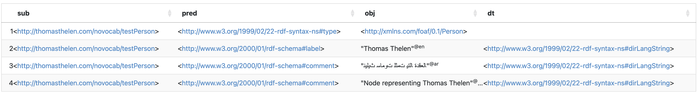

https://w3c.github.io/string-meta/#dfn-block-direction
https://w3c.github.io/wpub/#dfn-web-publications
https://www.w3.org/TR/WCAG21/
https://www.w3.org/TR/rdf12-concepts/#dfn-literal-term-equality
https://www.w3.org/2019/05/29-i18n-minutes.html

# Changes in RDF 1.2 (so far)

The working group responsible for RDF 1.2 is_____ set to be finalized during Q4 of 2025 marking another chapter for the technology stack that underlies an entire industry and host of web standards. The release is a combined effort of more than 50 contributors*, 2770 working group, mailing list emails**, and over three years of directed work***.

Almost 10 years ago, RDF 1.1 was released and the major changes included new serialization formats, support for RDF Datasets, and new datatypes (including `rdf:langString` which has changes in 1.2). RDF 1.2's biggest change has been long sought after: an overhaul to RDF's core to support a new form of reification, [inspired by the RDF* paper](https://github.com/w3c/sparql-dev/issues/114). This long sought after feature and has received the most exposure, with the first charter to work on RDF 1.2 going by *RDF Star Working Group Charter*. This was eventually recharted with a new name, the *RDF & SPARQL Working Group Charter*, to reflect that the update includes much more than just reification changes.

This post attempts to cover the substantial changes that knowledge graph and knowledge engineers will face in RDF 1.2. It does so by tracing back to the working group discussions . It is my hope that a historical perspective brings both clarity and admiration for those involved in the new version (note: I wasn't involved).

The article starts out with a broad overview of the RDF ecosystem to put constrains on what, and how many specifications have changes. Next, a brief history of the working group charter is covered to frame the changes within a larger context and to introduce how changes are made. Finally, the updates are covered. The changes to the core RDF specifications (see Holy Scriptures below) are covered first, followed by SPARQL, and finally the serialization formats.

## RDF Big Picture

Before digging into the changes - let's just make sure we're on the same page with what RDF *is*. Who owns it? Who is responsible for minting the next release? Who are the people that make the changes?

From a viewpoint of ownership we can say that RDF is owned by the W3C, who has around 50 staff and several hundred member organizations. It's common for changes to be driven by member organizations and individuals that are either interested in the topic or have some stake in it. In RDF's case, specifications are maintained by long-time contributors and take input from the graph community (database vendors, consulting shops, individuals, professors, students, etc). Together, the W3C forms a nexus for collaboration on driving future web standards.

W3C working groups form from time to time to tackle difficult problems that might require changes to existing specifications or entirely new ones. Sometimes the output of these groups results in a Community Group Report that covers the results of the group, but not as an official specification. These working groups operate transparently, are open to the public, and can be found [here](https://www.w3.org/groups/wg/). More information on how the W3C operates can be found in their [W3C Process Document](https://www.w3.org/policies/process/) but be warned - it's a dense read. The W3C's [GitHub](https://github.com/orgs/w3c/repositories?language=&q=rdf&sort=&type=all) is also a source for information on upcoming or decision process around different RDF features.

When we talk about RDF going through an update, it's really the set of documents that make up RDF that go through an update. The set of documents in question are made up by The Holy Scriptures and SPARQL (see later sections).

### The RDF & SPARQL Working Group Charter

Recall from the section above that W3C changes and investigations are driven by working groups. According to Oral Lassa, the [RDF Star Working Group Charter](https://www.w3.org/2022/08/rdf-star-wg-charter/) was formed after to . In ___, the first meeting for the  kicked off.

The first working group for the changes in RDF 1.2 was created through the . You'll note that both SPARQL *and* RDF were included in the same working group - despite being historically split. The decision making process can be traced through [this](https://github.com/w3c/rdf-star-wg-charter/issues/1) issue for the curious. Working groups typically last two years however, they can also be extended with approval if more time is needed. This group initially extended by a year; the discussion around it can be found in a [GitHub issue](https://github.com/w3c/strategy/issues/467).

The group underwent several more extensions as they worked on piecing together the changes before rechartering in 2025. The recharter included a name change from the original "RDF Star Working Group Charter" to "RDF & SPARQL Working Group Charter", to better reflect that there is *more* to RDF 1.2 than just the addition of RDF Star.

This is evident from several sources:

1. One reason to keep the name "RDF-star" for the group was to insist on
   the fact that other new features were, for the moment, out of scope. In
   hindsight, that was probably a bad move, creating wrong expectations on
   the scope of the group. - [Pierre-Antoine Champin](https://lists.w3.org/Archives/Public/public-rdf-star-wg/2023Jan/0091.html)

An important artifact from this effort is captured in their 2021 [community group report](https://w3c.github.io/rdf-star/cg-spec/2021-12-17.html). I take this document to be an "if we were to go through with an update, here's what it would look like". These are common outputs for working groups and help serve as reference points for discussion and feedback. You'll find that It's commonly referred to in the mailing list discussions and helped pave a major path forward for the release.

At one point - there was [an objection](https://www.w3.org/2025/04/rdf-star-council-report.html) to the working group and . I unfortunately don't have access to the W3C documents that elaborate on the underlying reasons for the objection however, the document seems to imply that the scope of addressing errata pushes too much scope into the group and goes against W3C policy. Fortunately, a consensus was reached by the 15 voting members (W3C people) to allow the working group to continue.

As of August, 2025 the working group has trudged forward with their deliverables and seem to hashing out several difficult errata in SPARQL, which is due by the end of the year.

### The Holy Scriptures

The core set of documents that make up the definitions and innards of RDF are listed below. The first group defines what RDF is; the second group defines the different ways to serialize it. When we talk about the "core" of RDF, these documents are usually the ones being referenced.

| Name | Description | W3C | GitHub |
| --- | --- | --- | --- |
| RDF 1.2 Concepts and Abstract Syntax | Defines key structures like what a graph/graph dataset is; definitions for IRI's, blank nodes, etc; defines core datatypes. | https://www.w3.org/TR/rdf12-concepts/ | https://github.com/w3c/rdf-concepts |
| RDF 1.2 Semantics | Covers entailment/reasoning strategies | https://www.w3.org/TR/rdf12-semantics/ | https://github.com/w3c/rdf-semantics |
| RDF 1.2 RDF Schema | RDFS vocabulary (extends RDF by offering a vocabulary for authoring vocabularies) | https://www.w3.org/TR/2014/REC-rdf-schema-20140225/ | https://github.com/w3c/rdf-schema |
| RDF 1.2 N-Triples | asdf | https://www.w3.org/TR/rdf12-n-triples/ | https://github.com/w3c/rdf-n-triples |
| RDF 1.2 N-Quads | asdf | https://www.w3.org/TR/rdf12-n-quads/ | https://github.com/w3c/rdf-n-quads |
| RDF 1.2 Turtle | asdf | https://www.w3.org/TR/rdf12-turtle/ | https://github.com/w3c/rdf-turtle |
| RDF 1.2 TriG | asdf | https://www.w3.org/TR/rdf12-trig/ | https://github.com/w3c/rdf-trig |
| RDF 1.2 XML Syntax | asdf | https://www.w3.org/TR/rdf12-xml/ | https://github.com/w3c/rdf-xml |

### SPARQL

Querying the data is of course important, so I've included the various SPARQL documents below. Like RDF, SPARQL is also formed by a tight knit ball of specifications where each one has a specific purpose and area of focus. Reading over the list below should spark your memory as certain keywords jump out.

| Name | Description | W3C | GitHub |
| --- | --- | --- | --- |
| SPARQL 1.2 zzzzz |  |  | https://github.com/w3c/sparql-concepts |
| SPARQL 1.2 Update | Describes the UPDATE keyword for mutating graphs. | https://w3c.github.io/sparql-update/spec/ | gh |
| SPARQL 1.2 Query Language | Describes the syntax and semantics for SPARQL | https://www.w3.org/TR/sparql12-query/ | https://github.com/w3c/sparql-query |
| SPARQL 1.2 Service Description | Describes how services can provide metadata (eg supported reasoning strategy, language, etc) about a sparql endpoint | https://www.w3.org/TR/sparql12-service-description/ | https://github.com/w3c/sparql-service-description |
| SPARQL 1.2 Federated Query | Describes how queries can be sent to remote SPARQL endpoints (mostly about the SERVICE keyword) | https://www.w3.org/TR/sparql12-federated-query/ | https://github.com/w3c/sparql-federated-query |
| SPARQL 1.2 Entailment Regimes | Outline of the different types of inferences that can happen during a SPARQL query | https://www.w3.org/TR/sparql12-entailment/ | https://github.com/w3c/sparql-entailment |
| SPARQL 1.2 Graph Store HTTP Protocol | Protocol describing how to interact with a triple store over HTTP | https://www.w3.org/TR/sparql12-graph-store-protocol/ | https://github.com/w3c/sparql-graph-store-protocol |
| SPARQL 1.2 Protocol | The overarching idea (protocol) of how SPARQL works | https://www.w3.org/TR/sparql12-protocol/ | https://github.com/w3c/sparql-protocol |
| SPARQL 1.2 Query Results JSON Format |  | https://www.w3.org/TR/sparql12-results-json/ | https://github.com/w3c/sparql-results-json |
| SPARQL 1.2 Query Results CSV and TSV Formats |  | https://www.w3.org/TR/sparql12-results-csv-tsv/ | https://github.com/w3c/sparql-results-csv-tsv |
| SPARQL 1.2 Query Results XML Format |  | https://www.w3.org/TR/sparql12-results-xml/ | https://github.com/w3c/sparql-results-xml |

### What about others?

There are a number of specification families that make use of RDF. These include JSON-LD, SHACL, N3, SWRL, RDFa, RIF, R2RML, OWL, etc. I haven't included these in this post as they're considered to be out of the RDF Core and are concerned by other W3C working groups. JSON-LD and SHACL both have updates around reification and language direction tags; they're worth looking into if you use either of these technologies.

Another issue with including the other projects within the working group is scope. Each of the projects above have their own stakeholders and working groups. Including half a dozen working groups into the RDF 1.2 changes would yield a project of unwieldly size: something the W3C and RDF WG members wanted to avoid.

## Update 1: String literals now have direction

Improving and providing guidance on accessability on the web has been a longstanding goal of the W3C. Their efforts have helped shape how internationalization takes form in HTML and other languages. RDF has long suffered from lacking one key element in this regard: the inability to specify the text direction of literals.

I've listed a few key documents, standards, and discussions that I believe influenced the features that we see today in RDF 1.2.

**Historical Documents**

| Description | Comments | Source |
| --- | --- | --- |
| RDF Literal Direction Working Group Charter | In 2019, a W3C working group was formed to investigate what it would take to incorporate the concept of language direction. | https://w3c.github.io/rdf-dir-literal/draft-charter.html |
| RDF Literal Direction Working Group | GitHub repository for the working group. | https://github.com/w3c/rdf-dir-literal |
| a | This is the output from the RDF Literal Direction Working Group. It contains a number of *potential* solutions for incorporating text direction within RDF. These ideas are referenced and evaluated later in RDF 1.2 discussions. | https://w3c.github.io/rdf-dir-literal |
| Text Direction Proposal | A 2023 proposal put together by Andy Seaborne that is a more refined ***_*** | https://github.com/w3c/rdf-star-wg/wiki/Text-Direction-Proposal |
| a | b | https://github.com/w3c/rdf-concepts/issues/9 |
| a | b | https://github.com/w3c/rdf-concepts/pull/48 |
| Internationalization Working Group | A W3C working group focused on internationalization of content on the web. Recommendations from this group heavily influenced RDF's text direction feature. | https://www.w3.org/groups/wg/i18n-core/ |
| Strings on the Web: Language and Direction Metadata | Best practices on implementing string directions from Internationalization Working Group. | https://w3c.github.io/string-meta/#dfn-block-direction |
| JSON-LD 1.1 | b | https://www.w3.org/TR/json-ld11/#context-definitions |

### TLDR

Saving you the trouble of reading though the rational and reasoning, RDF consumers and producers have a simple interface to this feature: add `--ltr` or `--rtl` at the end of a language tag. Database/SPARQL engines will handle the rest.

```
@prefix foaf: <http://xmlns.com/foaf/0.1/> .
@prefix rdfs: <http://www.w3.org/2000/01/rdf-schema#> .

<http://thomasthelen.com/novocab/testPerson> a foaf:Person ;
  rdfs:label "Thomas Thelen"@en--ltr ;
  rdfs:comment "Node representing Thomas Thelen"@en--ltr ;
  rdfs:comment "ﺎﻠﻌﻗﺩﺓ ﺎﻠﺘﻳ ﺖﻤﺜﻟ ﺕﻮﻣﺎﺳ ﺚﻴﻠﻴﻧ"@ar--rtl ;
```

tldr; The change from RDF 1.1 is support for `--ltr` and `--rtl` annotations on the language tags. The content below does a deeper dive into the internals of it. Keep in mind that there's an internal [note](https://w3c.github.io/rdf-dir-literal/) from 2020 that presents refined ideas around what string direction *could* look like. RDF 1.2 doesn't quite follow this pattern 100% - so don't treat it as holy scripture. For example, there is no `rdf:direction` that the note proposes.

### Back to Basics: String Direction on the Web?

When thinking about changes to RDF, it's important to frame them within the context of RDF being a web technology. RDF's original purpose was to provide a framework that can act as a second version of a web page - one that machines can easily parse; for human readable versions of web pages, we have HTML which has included the `dir` tag since in 1997. The HTML tag takes three relatively simple values: "ltr" for "left to left", "rtl" for "right to left", and "auto" when leaving the decision to the browser.

Recall that Unicode is *the* text encoding that everyone supports. It's governed by the Unicode Consortium, which laid down the original scripture on what it means for strings to have direction. Unicode's [BiDi](http://www.unicode.org/reports/tr9/) algorithm specifies the logical-to-visual reordering of the text with direction. The W3C's ***Web Accessibility Working Group*** provides guidance on how to incorporate Unicode's standard into other standards. Through this, it's trickled down through XML/HTML, CSS, SVG, and is now well on the way to being in RDF 1.2.

Note that Unicode is nothing new to RDF. From the rdf-core spec, we see that Unicode is baked into the fundamental representation of strings.

> RDF uses Unicode [Unicode] as the fundamental representation for string values. Within this and related specifications, the term RDF string, or simply string, is used to describe an ordered sequence of zero or more Unicode code points which are Unicode scalar values. Unicode scalar values do not include the surrogate code points. Note that most concrete RDF syntaxes require the use of the UTF-8 character encoding [RFC3629], and use the \u0000 or \U00000000 forms to express certain non-character values.

So it's pretty clear that there's already a synergy between what we call "text direction" and RDF.

### Strings in JSON-LD

It turns out that JSON-LD extended RDF to support direction a number years ago. The thought [came in 2018](https://github.com/w3c/wpub/issues/220) by Ivan Herman (the same one on the RDF Literal Direction Working Group). The GitHub issue above is linked to the following community group call where the idea was pitched, and voted out (even by Ivan).

> Ivan Herman: I put in a comment last week that I favor closing it
> … the problem that folks have is that of direction of the writing. There are some very confusing issue when writing for example Hebrew text with an English text in the middle with brackets. We can not properly represent that in JSON or JSON-ld. The real issue is that RDF can not represent that
> … thought we might be able to add it to JSON-ld to account for this. Similar to HTML. But there were some discussions in the original comment about extending things that are not in RDF - and decided to not do that
>
> As an extension to the RDF data model, literals without an explicit datatype MAY include a base direction. As there is currently no standardized mechanism for representing the base direction of RDF literals, the JSON-LD to standard RDF transformation loses the base direction.

The last paragraph serves as an example of how the limitations in RDF were affecting other working groups and standards. This is just one of the examples that gave rise to the changes we're seeing today. The statement also made it into the JSON-LD 1.1 spec. Ivan Herman opened a [second issue](https://github.com/w3c/wpub/issues/220) where the concept of text direction is discussed with the wider group and changes are eventually merged shortly after the initial issue & call.

Their solution looks something like this: Start by declaring the word "base direction" to mean the default, non-overridden direction of a string. Use the control property `@direction` as the predicate and use the `rtl` and `ltr` (inspired from HTML) as the range. By declaring this in the document *context*, you declare it for all strings that aren't overridden. The authors provide three main ways to set the string direction:

**Entire Document**

```
{
  "@context": {
    "@language": "en",
    "@direction": "ltr"
  },
    "name": "Thomas Thelen",
    "website": "http://thomasthelen.com"
}
```

**Specific Term: Expanded Term**

```
{
  "@context": {
    "name": {"@id": "ex:name", "@language": "ar", "@direction": "rtl"},
    "website": {"@id": "ex:website", "@language": "en", "@direction": "ltr"}
  },
    "name": "Thomas Thelen",
    "website": "http://thomasthelen.com"
}
```

**Specific Term: Value Expansion**
An even simpler way exists, which has a more explicit connection to what we see in RDF 1.2. This is done by defining a new object with `value`, `language`, and `direction` properties.

```
{
  "@context": {},
  "name": {
    "@value": "Thomas Thelen",
    "@language": "en",
    "@direction": "ltr"
  },
  "name": {
    "@value": "Thomas Thelen",
    "@language": "en",
    "@direction": "ltr"
  }
}
```

### Back to RDF...

Gregg Kellogg and Ivan Herman served on both the JSON-LD working group that brought text direction *and* on the RDF and SPARQL working group. They were also present Their experience in handling this feature in another RDF compliant spec brought similar ideas and parity within RDF.

So let's talk strings in RDF and where string direction fits in.

The RDF specification has a clear separation of the *value* of a literal and the literal itself. Literal *values* are associated with literals and can be broken into several classes.

Let's take quick recap on what it means for literals to be string literals and for string literals to be special *language tagged string* literals. Recall that there are *two* conditions (out of 4) that need to be met for a node to be classified as a Literal (these were taken directly from the standard):
1. A UNICODE compliant string, referred to as the *lexical form*. Think of this as the actual bytes of the data. eg "name", 123, etc
2. A datatype IRI, being an IRI identifying a datatype that determines how the lexical form maps to a literal value

Take for example the triples below that describe the latitude and longitude of something. The literals representing the coordinates have a valid lexical form and have associated datatypes. Folks, these are 100% genuine RDF literal values.

```
@prefix xsd: <http://www.w3.org/2001/XMLSchema#> .
@prefix tt: <http://www.thomasthelen.org/novocab#> .

[] a tt:GeoCoordinate ;
  tt:latitude "1234"^^xsd:int ;
  tt:longituude "4321"^^xsd:int .
```

There's a third optional condition which, when satisfied makes the literal a *language string*. This is a special datatype that means the literal value has a lexical form that corresponds to some natural language. You've most likely used these before either by querying for language specific values through SPARQL, or while writing data pipelines.

3. If and only if the datatype IRI is http://www.w3.org/1999/02/22-rdf-syntax-ns#langString, a non-empty language tag as defined by [BCP47]. The language tag MUST be well-formed according to section 2.2.9 of [BCP47]

> rdf:langString is an instance of rdfs:Datatype and a subclass of rdfs:Literal.

There's a good chance you've never set the type of a literal as `rdf:langString`. So when does it get set and by who? It turns out, when you have data with language tags such as the rdf below the datatype is inferred as `rdf:langString`.

And finally there's a *fourth* condition that can be met, which is completely new in RDF 1.2.

> If and only if the datatype IRI is http://www.w3.org/1999/02/22-rdf-syntax-ns#dirLangString, a base direction that MUST be one of the following:
>
> - ltr, indicating that the initial text direction is set to left-to-right
> - rtl, indicating that the initial text direction is set to right-to-left

Going full circle back with the turtle presented earlier, we can inspect the inferred datatypes from Jena with the following query

```
PREFIX rdf: <http://www.w3.org/1999/02/22-rdf-syntax-ns#>
PREFIX rdfs: <http://www.w3.org/2000/01/rdf-schema#>

SELECT * WHERE {
  ?sub ?pred ?obj .
  BIND(DATATYPE(?obj) AS ?dt )
}
```

The SPARQL results show that the strings have datatype `rdfs:dirLangString`, despite its absence from the input RDF.



### Exploring rdf:dirLangString (new in 1.2)

With the basics of string literals covered, we can now start to cover the new changes in 1.2.

Believe it or not, people have been thinking about string direction in RDF for at least a decade. One such effort of bringing string directions to RDF came from the [RDF Literal Direction Working Group Charter](https://w3c.github.io/rdf-dir-literal/draft-charter.html). Their notes and minutes can be found [here](https://github.com/w3c/rdf-dir-literal).

RDF 1.2's support for string direction looks a little terse however, the serialization formats make it easy to deal with (similar to RDF lists and collections).

The new additions to the RDF vocabulary are

```
rdf:CompoundLiteral a rdfs:Class ;
    rdfs:label "CompoundLiteral" ;
    rdfs:comment "A class representing a compound literal." ;
    rdfs:subClassOf rdfs:Resource ;
    rdfs:isDefinedBy <http://www.w3.org/1999/02/22-rdf-syntax-ns#> ;
    rdfs:seeAlso <https://www.w3.org/TR/json-ld11/#the-rdf-compoundliteral-class-and-the-rdf-language-and-rdf-direction-properties> .

rdf:language a rdf:Property ;
    rdfs:label "language" ;
    rdfs:comment "The language component of a CompoundLiteral." ;
    rdfs:domain rdf:CompoundLiteral ;
    rdfs:isDefinedBy <http://www.w3.org/1999/02/22-rdf-syntax-ns#> ;
    rdfs:seeAlso <https://www.w3.org/TR/json-ld11/#the-rdf-compoundliteral-class-and-the-rdf-language-and-rdf-direction-properties> .

rdf:direction a rdf:Property ;
    rdfs:label "direction" ;
    rdfs:comment "The base direction component of a CompoundLiteral." ;
    rdfs:domain rdf:CompoundLiteral ;
    rdfs:isDefinedBy <http://www.w3.org/1999/02/22-rdf-syntax-ns#> ;
    rdfs:seeAlso <https://www.w3.org/TR/json-ld11/#the-rdf-compoundliteral-class-and-the-rdf-language-and-rdf-direction-properties> .
```

From the class and property names - we can see the building blocks around language, direction, and the new class type for literals that can handle these properties. From a pure RDF modeling perspective,

```
@prefix foaf: <http://xmlns.com/foaf/0.1/> .
@prefix rdfs: <http://www.w3.org/2000/01/rdf-schema#> .

<http://thomasthelen.com/novocab/testPerson> a foaf:Person ;
  rdfs:label "Thomas Thelen"@en--ltr ;
  rdfs:comment "Node representing Thomas Thelen"@en--ltr ;
  rdfs:comment "ﺎﻠﻌﻗﺩﺓ ﺎﻠﺘﻳ ﺖﻤﺜﻟ ﺕﻮﻣﺎﺳ ﺚﻴﻠﻴﻧ"@ar--rtl ;
```

can be represented as

```
@prefix foaf: <http://xmlns.com/foaf/0.1/> .
@prefix rdfs: <http://www.w3.org/2000/01/rdf-schema#> .
@prefix rdf: <https://www.w3.org/1999/02/22-rdf-syntax-ns#> .

<http://thomasthelen.com/novocab/testPerson> a foaf:Person ;
  rdfs:label [
    a rdf:CompoundLiteral ;
    rdf:language "en" ;
    rdf:direction "ltr" ;
    rdf:value "Thomas Thelen";
  ];
  rdfs:comment [
    a rdf:CompoundLiteral ;
    rdf:language "en" ;
    rdf:direction "ltr" ;
    rdf:value "Node representing Thomas Thelen";
  ];
  rdfs:comment [
    a rdf:CompoundLiteral ;
    rdf:language "ar" ;
    rdf:direction "rtl" ;
    rdf:value "ﺎﻠﻌﻗﺩﺓ ﺎﻠﺘﻳ ﺖﻤﺜﻟ ﺕﻮﻣﺎﺳ ﺚﻴﻠﻴﻧ";
  ].
```

Note how the previous syntax using language tags was significantly easier. I don't expect anyone to model strings with the more verbose syntax.

An excellent writeup on the need for being able to denote the direction of a string literal can be found in [RDF Literals and Base Directions](https://w3c.github.io/rdf-dir-literal/). A longer dive into direction and why it matters can be found in [Strings on the Web: Language and Direction Metadata](https://www.w3.org/TR/string-meta). The gist is that other metadata formats support annotating the direction that a language tagged string should be processed in, RDF doesn't, and should.

> This problem has affected a number of specifications that define vocabularies expressed in, e.g., JSON-LD. These include Activity Streams [activitystreams-core], Verifiable Credentials [verifiable-claims-data-model], Web Publications [wpub], or Web of Thing [wot-thing-description]. There have been parallel discussions in the various Working Groups (see, e.g., VC issue #436, WPUB issue #354, or WoT issue #643) and was also discussed during the editorial work of [string-meta] (see, e.g., issue #12). All these discussions led to the same conclusion: because RDF cannot express this information, neither can JSON-LD or Turtle. In other words, this problem must be solved on the RDF level.

So there you have it. Other tools and specifications have the need to encode string direction - but they can't because they depend on RDF.

### String Equality

Because strings now have additional metadata, what are the changes around string equality?

The spec does a good job on outlining the three rules for string equality,

1. The language tags must match (or both missing language tags)
2. The directions must be the same
3. The string values must match

There's a slight change w.r.t the first point in RDF 1.2. In previous RDF versions equality between strings depended on the language tags being case sensitive equal. This meant that `"Thomas"@EN` and "Thomas"@en` were *not* equal. RDF 1.2 relaxes this to allow for normalizing the language tag to a case and treating them as equal. Most RDF tools already performed this normalization in RDF 1.1 so don't expect to see any bugs arise from this - but it's worth looking into your database's implementation.

**Example:**

Take the following turtle that describes six people, all with the name Mark. The test is going to be SPARQL selecting people based on their name to show how equality

```
<> a foaf:person ;
  foaf:name "Mark"

<> a foaf:person ;
  foaf:name "Mark"@en

<> a foaf:person ;
  foaf:name "Mark"@en--ltr

<> a foaf:person ;
  foaf:name "علامة" #"Mark" in Arabic

<> a foaf:person ;
  foaf:name "علامة"@ar

<> a foaf:person ;
  foaf:name "علامة"@ar--rtl
```

**Case 1: "Mark" vs "Mark"@en**

This case falls under Rule 1 which is concerned about the presence of language tags. Because "Mark" is missing language tags and because one can't be inferred, *these are not equal strings*.

**Case 2: "Mark"@en vs "Mark"@en--rtl**

In this case, *both* strings have language tags however, on has an associated direction while the other doesn't. Rule 2 states that the directions *must* be the same for these to be equal.

This is where things get a little tricky - the text representation is missing the direction. *This is just a serialization though*. Equality is defined through SP

**Case 3: "Mark" vs "علامة"**

The first two triples represent the same value however, their lexical form differs. In RDF, *these strings are *not* the same* by Rule 3.

**Possible Source of Confusion**

Keep an eye out on how your graph database handles the update. For example, if reasoning *isn't* performed on your language tagged strings - they may be missing directions which will break equality with newly inserted strings.

## Update 2 (rdf-semantics): Support for directional strings

With the core model updated, the

## Update 2 (rdf-turtle): Turtle Support for String Direction

## Update 2 : Triple Terms (reification)

Reification has been a long time goal of semantic reasoning systems. A goal of early frame based logic systems were to be able to make statements about statements. Take for example this exceprt from the 19000 paper, ASDF.

It was no surprise that being able to make statements about other statements was also an early goal for RDF, which has supported reification since __. Due to the long history of reification, both in thought and implimentation - it has _____

**Historical Documents**
| Description| Comments| Source|
|------------|---------|-------|
|Early JSON-LD draft for RDF-star support|-------| https://json-ld.github.io/json-ld-star/publications/2021-02-18.html|

There are several ways to achieve reification in RDF 1.1:

**1. Standard Reification**

The long-time blessed way of reifying in RDF is to use

The the following RDF that represents two people who have given each other nicknames.

```
<tt:Thomas> a foaf:Person;
    foaf:name "Thomas"
    foaf:knows <tt:Carl>

<tt:Carl> a foaf:Person;
    foaf:name "Carl"
    foaf:knows <tt:Thomas>
```

**2. Singleton**

**3. RDF***

In [2014, a paper](https://arxiv.org/abs/1406.3399) was published that proposed an extension to RDF, SPARQL, and Turtle where triple statements can be used in place of the subject and object slots. The major benefit for this syntax extension is that it reduces the verbosity of reified statements. This extension was then known as RDF*, which is now referred to as RDF-star within the context of the W3C inplimentation.

Example

```

```

### Triple Terms

Eight months after the RDF*'s paper's last revision in December of 2021, W3C created an [RDF Star Working Group Charter](https://www.w3.org/2022/08/rdf-star-wg-charter/) to investigate what it would take to merge the ideas into RDF proper. The output of this group has been codified into the official [RDF-star and SPARQL-star Draft Community Group Report](https://w3c.github.io/rdf-star/cg-spec/editors_draft.html) which has steered the work of its inclusion into RDF 1.2 under the concept named* Triple Term*.

Example of how RDF Star above looks under RDF 1.2

```

```

The most obvious change is that a new predicate, `rdf:reifies`, is present.

The

## Update 3 (rdf-core): RDF Version

While modeling in the most recent version of RDF is generally recommended, it's not a requirement. The RDF core was updated to include the notion of an *RDF version* to help data consumers parse RDF documents.

Other specifications such as __,___ and __ use this new convention

**Historical Documents**

|| Description| Comments| Source|
|------------|-------|---------|

The allowed values straight from the spec,

| Version | Syntax Semantics |
| --- | --- |
| "1.2" | RDF 1.2 syntax RDF 1.2 Semantics |
| "1.2-basic" | RDF 1.2 syntax without triple terms RDF 1.2 Semantics |
| "1.1" | RDF 1.1 syntax except for use of a version directive |

HTTP interfaces to RDF data are expected to transmit the information in HTTP responses within the `Content-Type` header, shown below (also taken from the spec). This is referred to as "Version Announcement" and will brought up again when looking at changes to serialization formats. If you maintain server infrastructure, view the [server-considerations](https://www.w3.org/TR/rdf12-concepts/#server-considerations) section on how to conform to version downgrades.

```
HTTP/1.1 200 OK
Content-Type: text/turtle; version=1.2
Location: http://example.com/document.ttl
```

It's also expected for servers supporting content negotiation to respect a request that specifies one of the above versions through the traditional `Accept` header. If you support content negotiation - the server considerations section above outlines how to handle requests for older versions when your data may rely on RDF 1.2 constructs.

## Update 3: SPARQL Support for Triple Terms

With triple statements added to the RDF core model, SPARQL needed an update to be able to parse the new graph pattern. If you've used SPARQL with RDF-star in the past, the changs will look minimal to you.

## Update 4: Serialization formats

The intimate connection between an RDF concept and how it's serialized means that whenever the specifications above change, the serialization formats may also need to change to accommodate new syntax requirements. For example, the XML Syntax spec (and many others) had to be updated between 1.1 and 1.2 to support the new *Concepts and Abstract Syntax* addition of triple terms (for reification).

### n-triples & n-quads

Recall that triples serialized under n-triples looks like

```
addfg
```

n-quads is the answer to "How do I serialize named graph information as n-triples?". The answer: Add another column for the graph name and call it n-quad. If the triples above were in a named graph `thomasthelen.com/myGraph`, its n-quad representation looks like

```
addfg
```

## Change xx (n-quads): n-quads are officially an extension of n-triples

This might be something that should have happened during the 1.1 release, but

## Change xx (n-quads): Updates to support triple statements

The syntax update for triple terms isn't terrible.

Using the ___ example, the n-triple and n-quad representation is the same (because there's no named graph).

```

```

The syntax change simply has the triple term in either the subject or object position, maintaining three column format.

## Change xx (turtle): Change 1: Stop using @prefix

When turtle was first, . Thw W3C is also [in the process](https://github.com/w3c/sparql-protocol/pull/28) of making this change for all 1.2 documents.

## Change xx (turtle): Updates to support triple statements

## Change xx (RDF/XML): Support for rdf:version

## Change xx (RDF/XML): Support for triple statements

## Update 5: Clarification around equality of blank nodes, rdf terms, and triple terms

## Update 6: Service Description Version Broadcast

## Update 7: New rdf:json datatype

https://github.com/w3c/rdf-concepts/issues/14

## Update 8: Dropping security requirement for

https://github.com/w3c/rdf-concepts/commit/35ef6bdc1df211d629e3e6e0e48fb1310c38fc05

https://github.com/w3c/rdf-concepts/issues/11

## Update 9: Quad gets a definition

https://github.com/w3c/rdf-concepts/issues/5

## Update 10: XML ___ restricted

https://github.com/w3c/rdf-concepts/issues/85

## Update 11: RDF Profiles

https://github.com/w3c/rdf-concepts/issues/70

## Update 12: Relaxing ill-typed terms

```
* Taken from the core [acknowledgments](https://www.w3.org/TR/rdf12-concepts/#acknowledgments-for-rdf-1-2). This is an underestimate as W3C staff are involved in administrative tasks and there are a number of people present on mailing lists that aren't on GitHub.
** Taken from https://lists.w3.org/Archives/Public/public-rdf-star-wg/
*** Only counting the active time of the Working Group. There are many more years of thought that went into RDF-Star alone before the formation of the working group.
```
